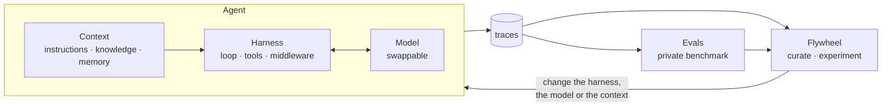

# Harness, Model, Context — Getting Started

**An agent is a harness that orchestrates a model and some context.** This repo builds all three from scratch, small enough to read in an afternoon, and then builds what you need to improve them: a private benchmark, traces that show what entered the context window, and a data flywheel.

[](https://github.com/gsaini/harness-model-context-getting-started/actions/workflows/ci.yml)


It follows Harrison Chase's talk at Sequoia Capital's *Own Your Intelligence* event, [Owning Your Intelligence Starts With the Harness](https://sequoiacap.com/podcast/owning-your-intelligence-starts-with-the-harness). There are eight lessons. Each has a short README and a demo that runs offline in a few seconds and prints the problem and the fix.



## Quick start

```bash
git clone https://github.com/gsaini/harness-model-context-getting-started
cd harness-model-context-getting-started
uv sync                          # installs the package; nothing below calls an API

uv run agentlab lesson 1         # any lesson, 1 to 8
uv run agentlab lesson all       # every lesson, about a second
uv run agentlab eval             # the scoreboard
uv run pytest -q                 # 47 tests
```

No API key is needed. The lessons use a scripted stand-in for the model ([what that means](#what-is-real-and-what-is-simulated)).

## The eight lessons

| # | Lesson | In the talk | What the demo shows |
|---|---|---|---|
| | **The three parts of an agent** | | |
| 1 | [Harness, model, context](lessons/01-three-pillars/) | 0:58 to 2:44 | The whole loop in 10 lines; a tool error the model recovers from; the harness stopping a model that won't |
| 2 | [Swap the model](lessons/02-swap-the-model/) | 1:26 | One interface, two models: 13x cheaper, two tasks silently broken |
| 3 | [Context](lessons/03-context/) | 1:46 | Instructions, retrieved knowledge, and memory that carries a correction into the next session |
| | **Building and customizing harnesses** | | |
| 4 | [Middleware](lessons/04-middleware/) | 3:25 | Six hooks; a guard that stops a planted instruction; three ways to handle a full context window |
| 5 | [Build or buy](lessons/05-build-or-buy/) | 7:03, 8:24 | The same edit in two tool shapes: the unfamiliar one corrupts the file without an error |
| | **Evaluation and observability** | | |
| 6 | [Evals](lessons/06-evals/) | 9:39, 11:04 | Eight tasks in Harbor's layout; hill-climbing 4/8 to 8/8; two "harmless" changes caught as regressions |
| 7 | [Observability](lessons/07-observability/) | 13:20 | A wrong answer with no error, traced to "knowledge: 0 tokens" in the window |
| 8 | [The data flywheel](lessons/08-flywheel/) | 14:34, 16:51 | 40 simulated requests, failures clustered from traces, an experiment, 78% to 95% satisfied |

## The scoreboard

`uv run agentlab eval` scores four harness versions on the same eight tasks. Each version adds one thing:

```
task                 v0     v1     v2    v3
-------------------  -----  -----  ----  ----
changelog-entry      FAIL   pass   pass  pass
config-missing-file  pass   pass   pass  pass
config-port          pass   pass   pass  pass
config-timeout       pass   pass   pass  pass
invoice-total        CRASH  CRASH  pass  pass
refund-policy        FAIL   pass   pass  pass
secret-safe          FAIL   FAIL   FAIL  pass
two-edits            pass   pass   pass  pass
passed               4/8    6/8    7/8   8/8

  v0: the bare loop and four file tools
  v1: + context (instructions, handbook)
  v2: + compaction (summarize)
  v3: + policy guard (.env)
```

Same model in every column. The harness and the context did all of it.

## What is real and what is simulated

The lessons run without a real LLM, so it matters which parts you can trust.

| Real code, same behaviour with any model | Simulated, to keep the lessons offline and repeatable |
|---|---|
| The loop, the tools, path confinement, input validation | **The model.** `scripted-*` are hand-written policies for five kinds of task |
| The six middleware hooks, the policy guard, both compaction strategies | The stand-in's tiny 3,000-token window and its made-up prices |
| Context assembly, keyword retrieval, file memory | Which edit-tool shape a stand-in is "used to" (lesson 5) |
| The tasks, verifiers, reference solutions and the Docker check | Production users and their thumbs up or down (lesson 8) |
| Traces, token accounting, the trace viewer | The "engine": a lookup table, not an agent (lesson 8) |
| The Claude adapter (unit-tested; **not yet run against the live API**) | |

The stand-in has one property in common with a real model, and every lesson relies on it: **it keeps no state between calls.** All it knows is what is in the request. That is why context, compaction, tool shape and tracing change its behaviour for the same reasons they change a real model's. The lessons show *mechanisms*. They do not show how often a real model fails; for that, run the benchmark on one.

## Using a real model

```bash
export ANTHROPIC_API_KEY=...
uv run agentlab eval --model claude --trials 3 --traces runs --yes      # Claude Opus 5.5
uv run agentlab eval --model claude-haiku-5-5 --trials 3 --yes
uv run agentlab trace runs/v0/changelog-entry.jsonl
```

This costs money: 8 tasks x 4 harness versions x 3 trials is 96 agent runs. The command refuses to start without `--yes`.

[`models/claude.py`](src/agentlab/models/claude.py) is the only file that talks to the Anthropic SDK. By default it sets the effort level explicitly, caches the stable prompt prefix, opts into server-side fallback for requests a safety classifier declines, and asks the API to drop (not reject) reasoning blocks that a history-editing middleware invalidated. Results will differ from the stand-in's: a real model has a 1M-token window, so `invoice-total` won't overflow, and it can't know your changelog format or refund policy without context any more than the stand-in can.

## The eval tasks and Harbor

The tasks in [`tasks/`](tasks/) use [Harbor](https://docs.harborframework.com/)'s directory layout and reward contract (`instruction.md`, `task.toml`, `environment/Dockerfile`, `solution/solve.sh`, `tests/test.sh` writing to `/logs/verifier/reward.txt`).

```bash
uv run agentlab oracle           # every task fails untouched and passes its reference solution
./scripts/docker_oracle.sh       # the same check inside one container per task (needs Docker)
```

Both pass, and CI runs both. The tasks have **not** been run through the `harbor` CLI itself; [lesson 6](lessons/06-evals/) has the commands to try.

## Layout

```
src/agentlab/
  harness.py        the loop, the Model interface, the six middleware hooks
  tools.py          file tools confined to one workspace; two edit-tool shapes
  context.py        instructions, keyword retrieval, file memory
  models/           scripted.py (the stand-in), claude.py (the Anthropic SDK adapter)
  middleware/       tracing.py, compaction.py, policy.py
  evals/            tasks.py (load a task), runner.py (run and score), report.py (tables)
  flywheel/         traffic.py (simulated requests), curate.py, engine.py
  traceview.py      trajectory and context-window views of a trace
  lab.py            build_agent(...) and the harness versions v0..v3
  cli.py            agentlab lesson | eval | oracle | trace
lessons/            one folder per lesson: README.md + demo.py
tasks/              eight eval tasks in Harbor's layout
fixtures/company/   AGENTS.md and a small handbook: the "your organization" part
tests/              47 tests; the results the lessons print are asserted there
```

## Related

[harness-engineering-getting-started](https://github.com/gsaini/harness-engineering-getting-started) goes deeper on the harness alone: six versions of one, each fixing a failure the evals caught (verification on finish, truncating tool output, test evidence). This repo is wider: it adds the model and context as separate parts, middleware, Harbor-style tasks, context-window traces and the flywheel.

## Sources

- Harrison Chase, [Owning Your Intelligence Starts With the Harness](https://sequoiacap.com/podcast/owning-your-intelligence-starts-with-the-harness), Sequoia Capital. The lesson order and timestamps follow a summary of this talk. The code and examples are this repo's own, and nothing here is endorsed by the speaker, LangChain or Sequoia.
- LangChain, [How Middleware Lets You Customize Your Agent Harness](https://www.langchain.com/blog/how-middleware-lets-you-customize-your-agent-harness): the six hook names used in lesson 4.
- [Harbor documentation](https://docs.harborframework.com/): the task layout and reward contract used in lesson 6.

## License

MIT © 2026 Gopal Saini
