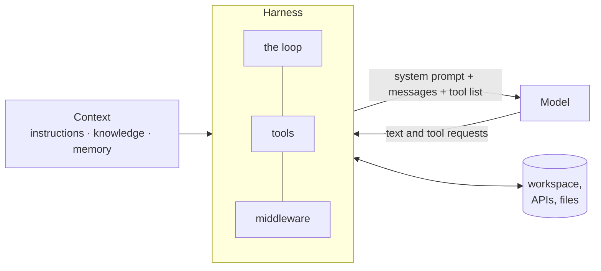

# Lesson 1 · An agent is a harness, a model and context

> **An agent is three separable parts: a model that decides, context that tells it about your world, and a harness that runs the loop.** Keep them separate and you can change one without rebuilding the other two.

*In the talk: 0:58 to 2:44.*



| Part | What it is | In this repo |
|---|---|---|
| **Model** | The LLM. It only ever produces text and requests to call tools. | [`models/`](../../src/agentlab/models/): a scripted stand-in, and Claude |
| **Context** | What the model is told about your project, your company, your user. | [`context.py`](../../src/agentlab/context.py), [`fixtures/company/`](../../fixtures/company/) |
| **Harness** | The code around the model: it builds the prompt, runs the tools, feeds results back, decides when to stop. | [`harness.py`](../../src/agentlab/harness.py), [`tools.py`](../../src/agentlab/tools.py) |

## The whole loop

This is [`Agent._loop`](../../src/agentlab/harness.py), with the middleware hooks left out:

```python
while state.step < self.max_steps:
    state.step += 1
    response = self.model.complete(system=state.system, messages=state.messages, tools=state.tools)
    state.messages.append(assistant(response.content))
    calls = [block for block in response.content if block["type"] == "tool_use"]
    if not calls:
        return "done"  # the model answered without asking for a tool
    state.messages.append(user([self._run_tool(call, state) for call in calls]))
return "max_steps"  # the harness says "enough"
```

Everything else in this course is something you add around those lines.

## Run it

```bash
uv run agentlab lesson 1
```

The task says `settings.json`, but the file is really at `config/settings.json`:

```
#1  window   599 tokens ( 20%)
    says:  I'll read settings.json before changing it.
    calls: read_file(path='settings.json')
    gets:  ERROR settings.json: no such file

#2  window   689 tokens ( 23%)
    says:  settings.json isn't there. I'll look for it instead of creating a new file.
    calls: list_files(dir='.')
    gets:  README.md config/settings.json

#3  window   779 tokens ( 26%)
    says:  Found it at config/settings.json.
    calls: read_file(path='config/settings.json')
    ...
end: done · 5 model calls · 4,127 tokens · $0.0149

verifier: PASS
```

And a model that never stops:

```
A model that never stops calling tools -> status: max_steps (stopped after 5 model calls)
```

## What to notice

- **A tool error is feedback, not a crash.** The harness turned "no such file" into a message for the model, and the model changed its plan. This is in `Agent._run_tool`.
- **The window grows every turn.** Each step re-sends everything so far, plus the newest result. Lesson 4 deals with what happens when it fills up.
- **The harness owns the stop condition.** A model can loop forever. `max_steps` is the simplest guard there is.

## What is simulated

The model is [`scripted-careful`](../../src/agentlab/models/scripted.py), a stand-in that runs offline and gives the same answer every time. It has one property in common with a real model, and the lessons depend on it: **it keeps no state between calls.** Everything it knows is in the request it receives. The loop, the tools and the error handling are real, and work the same with Claude (lesson 2).

<details><summary><b>Check yourself</b></summary>

1. **Which of the three parts ran `read_file`?** The harness. The model only asked for it.
2. **Why didn't the missing file end the run?** The harness returned the error as a tool result, so the model saw it and adapted.
3. **Name two ways a run ends.** The model replies with no tool call, or the harness reaches `max_steps`. (A model error or a refusal also ends it.)

</details>

**Next →** [Lesson 2 · Swap the model](../02-swap-the-model/)
