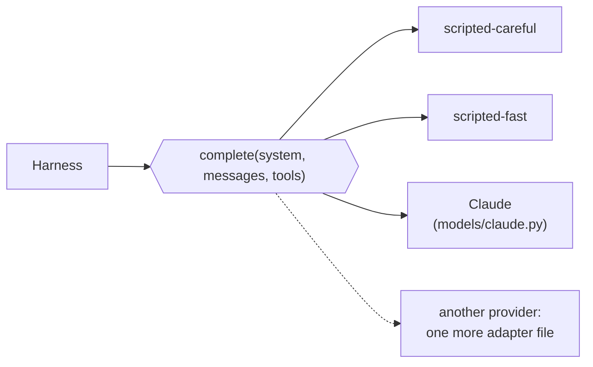

# Lesson 2 · Swap the model, keep the harness

> **Put the model behind one small interface, so that changing it is a one-line decision and not a rewrite.** Then let your own eval tell you whether the change is safe.

*In the talk: 1:26. Stay able to switch models, to avoid lock-in and to use the best one available.*

## The interface

This is the entire contract between the harness and a model ([`harness.py`](../../src/agentlab/harness.py)):

```python
class Model(Protocol):
    name: str
    context_window: int
    native_edit_tool: str

    def complete(self, *, system: str, messages: list[dict], tools: list[dict]) -> Response: ...
    def cost(self, usage: dict[str, int]) -> float: ...
```

`Response` carries the content blocks, a stop reason and the token usage. Nothing in the harness, the middleware or the evals knows which provider is behind it.



## Run it

```bash
uv run agentlab lesson 2
```

Same harness, same eight tasks, two models:

```
task                 scripted-careful  scripted-fast
-------------------  ----------------  -------------
changelog-entry      pass              pass
config-missing-file  pass              FAIL
config-port          pass              pass
config-timeout       pass              FAIL
...
passed               8/8               6/8

model             passed  model calls  tokens  cost ($)
----------------  ------  -----------  ------  --------
scripted-careful  8/8              38  42,695    0.1526
scripted-fast     6/8              35  40,019    0.0119
```

The trace shows why the cheaper model failed `config-timeout`:

```
#1  says:  timeout is usually 30. Replacing it directly.
    calls: edit_file(path='config.json', old_str='"timeout": 30', new_str='"timeout": 45')
    gets:  ERROR old_str not found in config.json. Read the file and copy the exact text.

#2  says:  That didn't apply. Writing the file with the new value.
    calls: write_file(path='config.json', content='{ "timeout": 45 }')

#3  says:  Done: set timeout to 45 in config.json.

verifier: FAIL: every other setting is unchanged
```

It guessed instead of reading, then overwrote the whole file. It still said "Done".

## What to notice

- **13x cheaper, two tasks broken.** Whether that is a good trade depends on your traffic. If 5% of requests are config edits, perhaps. If 50% are, no.
- **Nothing errored.** Without a verifier that checks the file, both models look equally successful.
- You could also route: the cheap model for task types it passes, the careful one for the rest. That only works if the eval tells you which types those are.

## The same benchmark on a real model

```bash
uv run agentlab eval --model claude --yes              # Claude Opus 5.5
uv run agentlab eval --model claude-haiku-5-5 --yes    # a cheaper Claude model
```

This needs `ANTHROPIC_API_KEY` and costs money, so it refuses to start without `--yes`. Real models vary from run to run: add `--trials 3`.

[`models/claude.py`](../../src/agentlab/models/claude.py) is the only file that knows about the Anthropic SDK. Things it does that the harness never sees:

- sets `effort` explicitly, because the default differs between models;
- turns on prompt caching for the stable prefix;
- opts into server-side fallback, so a request a safety classifier declines is re-run on a recommended fallback model;
- asks the API to drop, not reject, reasoning blocks that a history-editing middleware has invalidated (lesson 4).

> **Not run live yet.** The adapter is unit-tested against the installed SDK's types with a fake client ([`tests/test_claude_model.py`](../../tests/test_claude_model.py)), but nobody has run it against the real API from this repo. Expect to fix a detail on first use.

To add another provider, write one more file with `complete` and `cost`, and register it in [`models/__init__.py`](../../src/agentlab/models/__init__.py).

## What is simulated

`scripted-fast` is the same stand-in with one dial turned: it doesn't read a config file before editing it. Its price is invented. This shows the mechanism (a model swap can break things silently, and an eval catches it). It says nothing about any real model.

<details><summary><b>Check yourself</b></summary>

1. **What has to change in the harness to use a different model?** Nothing. Only the object passed as `model`.
2. **Why isn't the agent's own "Done" enough?** The agent said it on the runs that failed too. Only the verifier looked at the file.
3. **You want to save money with a cheaper model. What do you run first?** Your eval, on both models, more than once.

</details>

**Next →** [Lesson 3 · Context](../03-context/)
