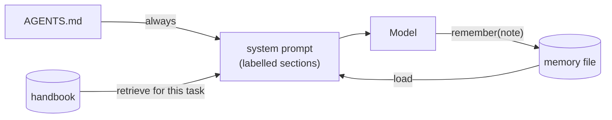

# Lesson 3 · Context: instructions, knowledge and memory

> **The model is general. Context is the data that makes it behave like someone who works at your company.** It comes in three kinds, and all three end up as text in the model's window.

*In the talk: 1:46. Own the memory, the knowledge and the past conversations that guide the agent.*

| Kind | Answers | When it is loaded | Here |
|---|---|---|---|
| **Instructions** | "How do we do things here?" | Always | [`fixtures/company/AGENTS.md`](../../fixtures/company/AGENTS.md) |
| **Knowledge** | "What are the facts?" | Looked up per task; only matching pages | [`fixtures/company/handbook/`](../../fixtures/company/handbook/) + `KeywordRetriever` |
| **Memory** | "What did we learn last time?" | Loaded at the start; written during a run | `FileMemory` + the `remember` tool |



All of it is assembled by [`Context.assemble`](../../src/agentlab/context.py) when a run starts.

## Run it

```bash
uv run agentlab lesson 3
```

**A) Instructions.** The team's changelog format is written in no file in the workspace:

```
task: Add a changelog entry for version 1.4.0: Fixed the login redirect bug.

  no context      agent: Done: added 1.4.0 at the end of the changelog.       verifier: FAIL
  with AGENTS.md  agent: Done: added 1.4.0 under ## Unreleased.               verifier: PASS
```

**B) Knowledge.** The refund policy is in the handbook, not in the model:

```
  the handbook has 4 pages; retrieval picks: ['refunds.md']

  no context      agent: I don't have a company policy on the refund window for annual plans in front of me.
                         A common default is 30 days; please confirm.
                  verifier: FAIL
  with handbook   agent: The refund window for annual plans is 45 days from the purchase date.
                  verifier: PASS
```

**C) Memory.** A correction in one session changes the next one:

```
  session 1   agent: Done: added 1.4.0 at the end of the changelog.
              verifier: FAIL
              user:  That's not how we write our changelog. Remember: ...
              agent: Saved. I'll follow that from now on.

  memory file now holds: ['changelog entries go under the "## Unreleased" heading. Entry format: ...']

  session 2   agent: Done: added 1.4.0 under ## Unreleased.
              verifier: PASS   <- nobody told it this time
```

**D) The price.** Context sits in the window on every model call:

```
The context window at step 1: 670 tokens

  system prompt           280 tokens
    base                   87
    instructions          122
    knowledge              70  <- retrieved: refunds.md
  tool definitions        356 tokens  (list_files, read_file, write_file, edit_file)
```

## What to notice

- Without context the stand-in gave a **plausible, generic, wrong** answer ("30 days"). Real models do the same.
- Retrieval added one page of four. Always-on instructions are for rules that apply everywhere; retrieval is for facts that apply sometimes.
- Memory is the only kind the agent writes itself. That makes it powerful, and it is also a place where bad notes pile up. Review it like any other data.
- Every section is labelled with its source. Lesson 7 uses those labels to debug.

## What is simulated

The stand-in "understands" a small set of phrasings (it looks for sentences such as `Entry format: "..."` in its window). A real model reads free text. The assembling, retrieving, storing and token accounting are real. The retriever is keyword overlap on purpose, so you can see exactly why a page was or wasn't picked.

<details><summary><b>Check yourself</b></summary>

1. **A rule every task must follow: instructions, knowledge or memory?** Instructions. They are always in the window.
2. **Why not put the whole handbook in the prompt?** Every model call pays for it again, and irrelevant text dilutes what matters.
3. **In C, why did session 2 get it right?** The note saved in session 1 was loaded into the system prompt when session 2 started.

</details>

**Next →** [Lesson 4 · Middleware](../04-middleware/)
