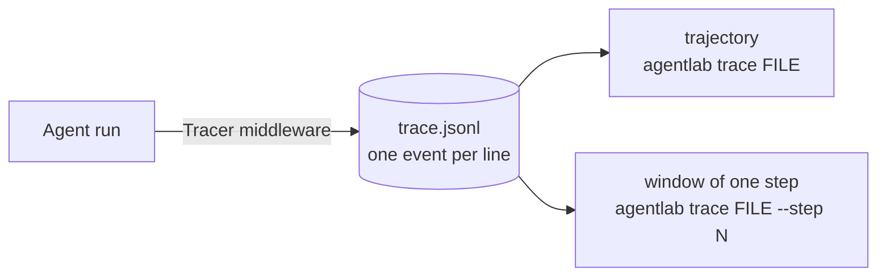

# Lesson 7 · Observability: what was in the window?

> **When an agent gets something wrong, look first at what the model was given.** More often than not the model did a reasonable job with poor context. You can only see that if you record exactly what entered the context window.

*In the talk: 13:20.*

Two views of one trace:

| View | Shows | Answers |
|---|---|---|
| **Trajectory** | The sequence of thoughts, tool calls and results | *What did the agent do?* |
| **Window** | Everything one model call was sent, labelled by source | *Why did it do that?* |



## A debugging story

```bash
uv run agentlab lesson 7
```

This team keeps its changelog conventions in the knowledge base, in [`kb/release-process.md`](kb/release-process.md). The agent still gets it wrong.

**From the outside**, there is nothing to go on:

```
agent:    Done: added 1.4.0 at the end of the changelog.   (status: done, no errors)
verifier: FAIL: the entry is the first line under ## Unreleased
```

**The trajectory** shows what it did, and a hint:

```
#2  says:  Nothing in my context says how this project formats its changelog, so I'll append a plain entry at the …
    calls: write_file(path='CHANGELOG.md', ...)
```

**The window at step 2** shows why:

```
The context window at step 2: 627 tokens

  system prompt           136 tokens
    base                   87
    instructions           49
    knowledge               0  <- retrieval ran and found NOTHING
  tool definitions        356 tokens
  messages
    user            25  Add a changelog entry for version 1.4.0: Fixed the login redirect bug.
    model calls     24  read_file(path='CHANGELOG.md')
    tool result     47  # Changelog ## Unreleased - **1.3.1** — ...
```

The page exists. It never reached the model.

**The cause** is a vocabulary gap in retrieval:

```
keywords in the task:    ['add', 'bug', 'changelog', 'entry', 'fixed', 'login', 'redirect', 'version']
keywords in the page:    [..., 'note', 'process', 'release', ..., 'version']
shared:                  ['version']   (retrieval needs at least 2)
The task says "changelog"; the page says "release notes".
```

**The fix** is one retrieval setting (`aliases={"changelog": "release"}`). Nothing about the model changed:

```
verifier: PASS

    knowledge              54  <- retrieved: release-process.md
```

## What to notice

- The model was never the problem. Swapping to a bigger one would have cost more and failed the same way.
- **Label every part of the prompt with where it came from.** "knowledge: 0 tokens" took one glance. Finding it by reading a raw prompt would have taken much longer.
- Keep the full request for each model call, not only the messages. The system prompt and tool list are part of the window too. Here they are more than half of it.

## Traces as files

```bash
uv run agentlab eval --traces runs                               # one .jsonl per run
uv run agentlab trace runs/v0/invoice-total.jsonl                # the trajectory
uv run agentlab trace runs/v1/refund-policy.jsonl --step 1       # one window
```

Each line of a trace is one event: `run_start`, `model_call` (with the full request, the response and a token breakdown), `tool_call`, `compaction`, `blocked`, `run_end`. The recorder is [`middleware/tracing.py`](../../src/agentlab/middleware/tracing.py); the viewer is [`traceview.py`](../../src/agentlab/traceview.py).

With Claude, the trace also keeps anything the API changed in your input. If a middleware edited history and the API dropped reasoning blocks because of it, each drop appears in the model call's `meta`.

## What is simulated

The stand-in announces "nothing in my context says how…". A real model usually won't be that helpful; it will simply do something plausible. That makes the window view matter more, not less. The tracing itself is real and records the same data for any model.

<details><summary><b>Check yourself</b></summary>

1. **The agent did the wrong thing with no error. Which view do you open first?** The window of the step where it decided, to see what it knew.
2. **Why store the system prompt in every model-call event?** It is part of what the model saw, and it is where context lands.
3. **Would a better model have fixed this run?** No. The convention was not in the window for any model to read.

</details>

**Next →** [Lesson 8 · The data flywheel](../08-flywheel/)
