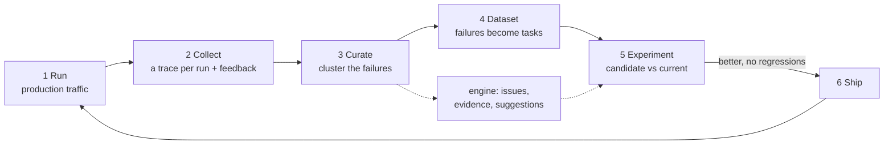

# Lesson 8 · The data flywheel

> **Improvement is a loop: run the agent, keep the traces, curate the failures into a dataset, experiment, ship. Then go round again.** Each turn makes the eval better and the agent better.

*In the talk: 14:34 (the flywheel) and 16:51 (LangSmith Engine, a tool that sits on production traces and suggests improvements).*



## Run it

```bash
uv run agentlab lesson 8
```

**1) Run.** A day of traffic on the current harness:

```
40 requests: config 16, invoices 10, changelog 6, question 6, out-of-scope 2
thumbs up 31, thumbs down 9  (78% satisfied)
```

**2) Collect and curate.** Group the unhappy runs by what their traces show:

```
signature               runs  what the traces have in common
----------------------  ----  ---------------------------------------------------------------------
context_overflow           5  crashed at model call 10, with tool results filling 65% of the window
declined                   2  the agent made 0 tool calls in every one of these runs
no_knowledge_retrieved     2  retrieval ran and returned 0 pages in every one of these runs
```

**3) Suggest.** One issue per cluster, with evidence and the part of the agent to change:

```
[harness] Runs crash when the conversation outgrows the context window  (5 runs: req-004, req-008, ...)
    suggestion: Turn on summarizing compaction.

[product] Requests the agent has no way to do  (2 runs: req-006, req-027)
    seen in:    Draw an architecture diagram for this project.; Book a meeting with the security team for Friday.
    suggestion: No harness fix. Decide whether the agent should support these, and build the tools if so.

[context] Questions answered with nothing retrieved from the handbook  (2 runs: req-012, req-018)
    seen in:    trial length for team plans (x2)
    suggestion: Add reference pages for the topics below, or loosen retrieval if the pages already exist.
```

**4) Dataset.** Failing runs become regression tasks:

```
benchmark = 8 core tasks + 5 tasks promoted from production
```

**5) Experiment.** The candidate adds compaction (a harness change) and one handbook page a person wrote, [`fixtures/proposed/pricing.md`](../../fixtures/proposed/pricing.md) (a context change):

```
harness  passed  model calls   tokens  cost ($)
-------  ------  -----------  -------  --------
prod-v1  7/13             67   82,829    0.2845
prod-v2  13/13            84  113,623    0.3995

fixed:     invoice-total, prod-req-004, prod-req-008, prod-req-032, prod-req-012, prod-req-018
regressed: nothing
decision:  ship prod-v2
```

**6) Ship, and go round again:**

```
before: thumbs up 31, thumbs down 9  (78% satisfied)
after:  thumbs up 38, thumbs down 2  (95% satisfied)
still open: [product] Requests the agent has no way to do (2 runs). ...
```

## What to notice

- **Each fix landed in a different part of the agent**: one in the harness, one in the context. Neither needed a different model. That is why lesson 1 separates the three.
- **The dataset grew.** The benchmark went from 8 tasks to 13, and the five new ones are failures real traffic produced. Next time someone turns compaction off to save tokens, the benchmark will say so.
- **The better version costs more** (40% higher cost on the benchmark). The experiment table makes that visible before you ship.
- **Trace-reading tools find small, specific failures.** The two out-of-scope requests are still open after the fix. No trace can tell you what your agent should be for.

## Where feedback comes from

In production nobody gives you a verifier. You collect signals:

| Signal | Cost | Example |
|---|---|---|
| Errors and limits | free | crashes, step limit reached |
| Implicit feedback | free, needs product design | the user re-asks, edits the output, abandons the task |
| Explicit feedback | cheap, sparse | thumbs up or down |
| Online evaluators | code is cheap; an LLM judge on every run adds up | "did the answer cite the handbook?" |

Curation in this lesson uses only the first and third, plus the trace ([`flywheel/curate.py`](../../src/agentlab/flywheel/curate.py)).

## What is simulated

A good deal, so here it is plainly:

- **The users are a script.** [`flywheel/traffic.py`](../../src/agentlab/flywheel/traffic.py) generates 40 requests from a seed.
- **Their thumbs come from a hidden check** attached to each request. The curation code never sees the check, only the thumb and the trace.
- **The "engine" is a lookup table** ([`flywheel/engine.py`](../../src/agentlab/flywheel/engine.py)) from failure signature to suggestion. The real thing uses an agent to read traces and can propose changes nobody listed in advance. Ours shows where such a tool sits in the loop: after curation, before the experiment.
- **A person wrote the new handbook page.** The engine only said which topics were missing.

The loop, the traces, the promotion of failures to tasks, the experiment and the before/after numbers are real.

<details><summary><b>Check yourself</b></summary>

1. **Why turn failing runs into benchmark tasks and not only fix them?** So the same failure can't come back unnoticed.
2. **The engine suggests a fix. Why still run the experiment?** A suggestion is a hypothesis. The experiment shows whether it helps and whether it breaks anything.
3. **Which failures here could no harness change fix?** The out-of-scope requests. They are a product decision.

</details>

**Back to →** [the overview](../../README.md)
